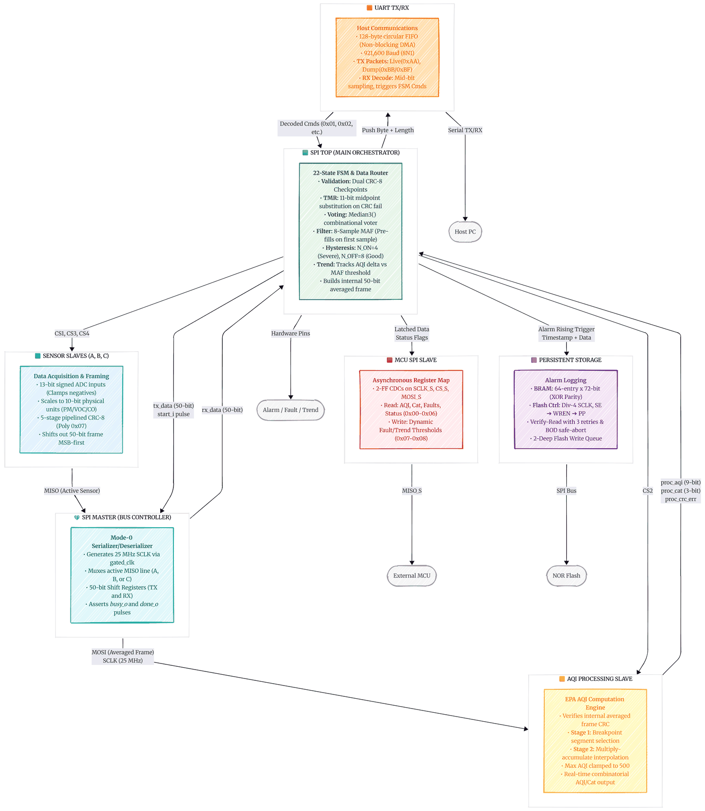
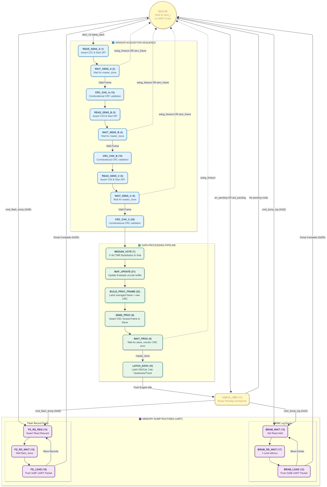
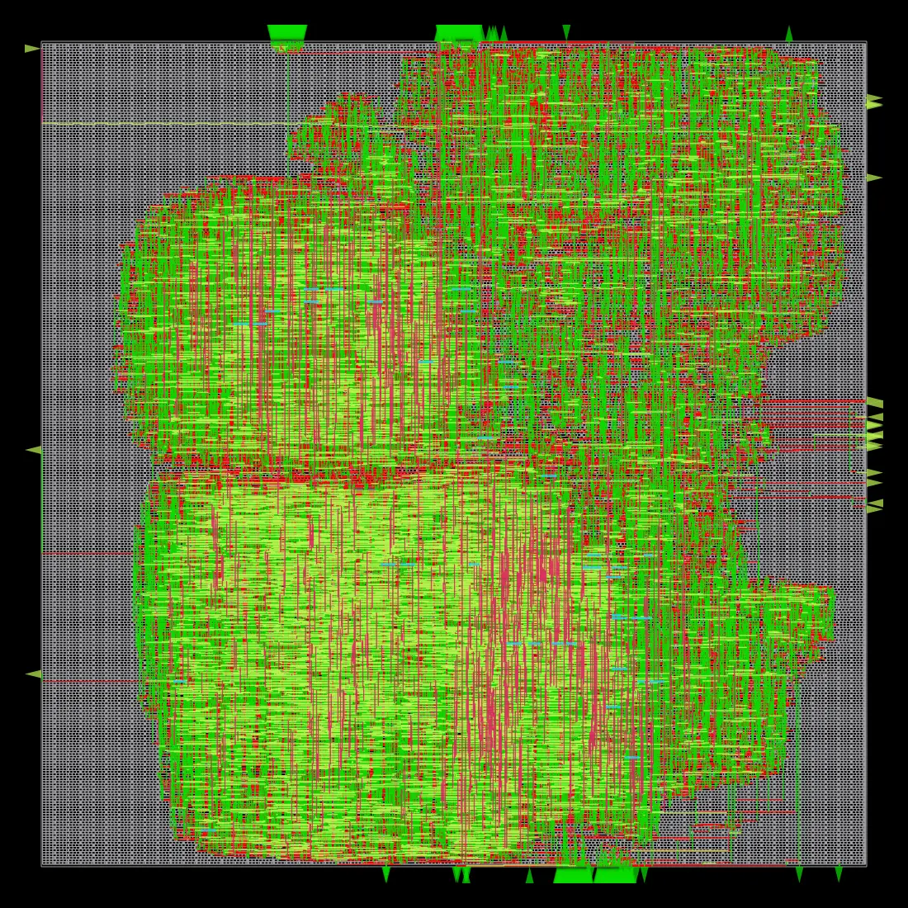
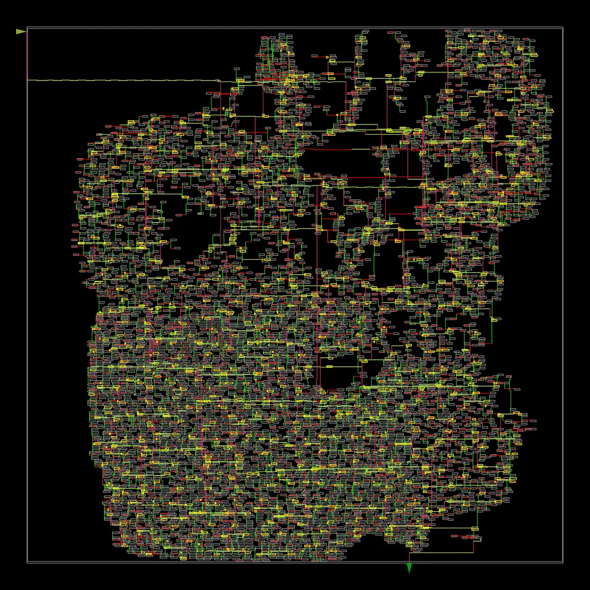

# SPI Air-Quality Monitoring System

A synthesizable Verilog design that reads four pollutant channels (PM2.5, PM10,
VOC, CO) from three redundant sensor nodes over SPI, rejects faulty readings,
computes a US-EPA style Air Quality Index, raises a debounced alarm, logs alarm
events to on-chip memory and SPI flash, and reports everything to a host over
UART.

The RTL is verified with a 60-test self-checking testbench and has been taken
from RTL to a routed layout with the open-source OpenROAD flow on the SkyWater
130 nm process. Every result on this page can be reproduced with free tools.

<p align="center">
  <a href="docs/Image/flow.png"></a>
</p>

## Contents

- [Key figures](#key-figures)
- [How it works](#how-it-works)
- [Interfaces](#interfaces)
- [Repository layout](#repository-layout)
- [Simulation](#simulation)
- [Physical implementation](#physical-implementation)
- [Documentation](#documentation)
- [Authors](#authors)
- [License](#license)

## Key figures

| Item | Value |
|------|-------|
| System clock | 100 MHz |
| Sensor SPI bus | Mode 0, 25 MHz (system clock / 4), 50-bit frames |
| Pollutant channels | PM2.5, PM10, VOC, CO (10 bits each) |
| Redundancy | Three sensor nodes, median-of-three voter per channel |
| Error detection | CRC-8 (polynomial 0x07, seed 0xFF) at two checkpoints |
| Filtering | 8-sample moving average per channel |
| AQI | Piecewise-linear EPA breakpoints, 2-stage pipeline, range 0 to 500 |
| Alarm | Hysteresis: 4 consecutive Severe readings to set, 8 Good readings to clear |
| Alarm log | 64 entries x 72 bits on chip, plus SPI NOR flash with verify and retry |
| Host link | UART 921,600 baud, 8N1, 128-byte transmit FIFO |
| MCU readback | Separate SPI slave port with 9 registers |
| Main FSM | 23 states |
| Verification | 60 tests, 146 checks, all passing; 14 formal properties written |

## How it works

One measurement cycle passes through eight stages.

| Stage | Module | What happens |
|-------|--------|--------------|
| 1. Acquire | `spi_sensor_slave` x 3 | Signed 13-bit ADC values are clamped at zero, scaled to 10-bit physical units and framed with a pipelined CRC-8. |
| 2. Transfer and check | `spi_master`, `spi_top` | Each 50-bit frame is read over SPI and its CRC is recomputed. |
| 3. Vote | `spi_top` | A sensor that failed CRC is replaced by the midpoint of the other two, then the median of the three is taken per channel. A sensor that strays from the median is flagged. |
| 4. Filter | `spi_top` | Each channel goes through an 8-sample moving average, pre-filled on the first sample. |
| 5. Compute AQI | `spi_processing_slave` | The averaged values are packed into a new frame with a fresh CRC and sent to the processing slave, which checks the CRC and computes AQI and category. This is the only place AQI is computed. |
| 6. Alarm | `spi_top` | Category feeds the hysteresis counters; a trend flag compares the new AQI with its moving average. |
| 7. Log | `alarm_bram`, `spi_flash_ctrl` | Each alarm onset is written to the on-chip log (with parity) and to SPI flash (write, verify, up to 3 retries, safe abort on brown-out). |
| 8. Report | `uart_tx`, `uart_rx` | A live packet is queued in the FIFO; the host can also request log dumps. |

A watchdog returns the FSM to idle if a sensor stops answering, and a sleep
input gates the SPI master clock.

<p align="center">
  <a href="docs/Image/main_fsm.png"></a>
</p>

Per-module diagrams (FSMs and datapaths for the SPI master, flash controller,
UART, alarm log, register map and processing slave) are in
[docs/Image](docs/Image).

### SPI buses

```
Sensor bus (shared MOSI and SCLK, 25 MHz)
  cs1 -> sensor A        cs3 -> sensor B        cs4 -> sensor C
  cs2 -> processing slave

MCU port     sclk_s_i, cs_s_i, mosi_s_i, miso_s_o          -> spi_slave
Flash port   flash_sclk_o, flash_cs_o, flash_mosi_o, flash_miso_i -> spi_flash_ctrl
```

## Interfaces

### Frame layout (50 bits, MSB first)

```
[49:40] PM2.5   0-499 ug/m3        [19:10] CO      0-999 ppm
[39:30] PM10    0-599 ug/m3        [ 9: 8] unused, always 0
[29:20] VOC     0-999 ppb          [ 7: 0] CRC-8 over bits [49:10]
```

The frame sent from `spi_top` to the processing slave uses the same layout but
carries the voted and averaged values with a newly generated CRC.

### AQI categories

| Code | Label | AQI |
|------|-------|-----|
| 0 | Good | 0 - 50 |
| 1 | Moderate | 51 - 100 |
| 2 | Unhealthy | 101 - 200 |
| 3 | Severe | 201 - 300 |
| 4 | Very Severe | 301 - 400 |
| 5 | Hazardous | 401 - 500 |

### UART packets (device to host)

| Packet | Header | Length | Contents |
|--------|--------|--------|----------|
| Live reading | 0xAA | 4 | AQI[8], AQI[7:0], {input_err[3:0], crc_err, category[2:0]} |
| Alarm log entry | 0xBB | 9 | index, timestamp[31:0], AQI[7:0], flags, reserved |
| Flash record | 0xBF | 9 | index, timestamp[31:0], AQI[7:0], flags, reserved |
| End of dump | 0xDD | 1 | sent after the last log or flash record |
| Acknowledge | 0xCC | 1 | reply to commands 0x01 and 0x04 |
| Error | 0xEE | 2 | 0x01 = watchdog timeout |

### UART commands (host to device)

| Byte | Action |
|------|--------|
| 0x01 | Send the latest live reading |
| 0x02 | Dump the on-chip alarm log |
| 0x03 | Clear the alarm log |
| 0x04 | Wake from sleep |
| 0x06 | Dump the alarm records stored in flash |

### MCU register map

First byte: bit 7 = 1 to read, bits 6:0 = address.

| Address | Register | Width | Contents |
|---------|----------|-------|----------|
| 0x00 | PM2.5 | 16 | averaged PM2.5 |
| 0x01 | PM10 | 16 | averaged PM10 |
| 0x02 | VOC | 16 | averaged VOC |
| 0x03 | CO | 16 | averaged CO |
| 0x04 | AQI | 16 | current AQI (0 - 500) |
| 0x05 | Category | 8 | 0 = Good ... 5 = Hazardous |
| 0x06 | Status | 8 | {alarm, crc_err, timeout, sleep, 4'b0} |
| 0x07 | Faults | 8 | read: sensor_fault[2:0]; write: fault threshold |
| 0x08 | Trend | 8 | read: trend_rising; write: trend threshold |

## Repository layout

```
rtl/                      synthesizable RTL
  spi_top.v                 top level: FSM, CRC checks, voter, filters, alarm, FIFO
  spi_master.v              SPI mode 0 master
  spi_sensor_slave.v        sensor framing, scaling and CRC
  spi_processing_slave.v    AQI computation
  spi_slave.v               MCU register map
  alarm_bram.v              alarm log with parity
  spi_flash_ctrl.v          SPI flash write / verify / read controller
  uart_tx.v, uart_rx.v      UART and command decoder
  spi_flash_model.v         behavioural flash model (simulation only)
  spi_top_props.sv          assertions bound to spi_top (formal / SVA simulators)
tb/spi_tb.v               self-checking system testbench
scripts/run_sim.sh        compile and run the testbench with Icarus Verilog
results/simulation/       console log of the last regression run
openroad/                 OpenROAD flow: configuration, constraints, reports, layout images
synthesis/                Cadence Genus script and constraints
docs/                     design history and diagrams
```

## Simulation

Requirements: [Icarus Verilog](https://github.com/steveicarus/iverilog)
(tested with version 12.0). GTKWave is optional for viewing `dump.vcd`.

```bash
bash scripts/run_sim.sh
```

The testbench drives the whole system, checks every result itself and prints a
per-test table. Expected last lines:

```
| TOT  | All Tests                                |  146 |    0 |
```

That is 146 checks passed and 0 failed across 60 tests. The full console output
of the last run is in
[results/simulation/regression.txt](results/simulation/regression.txt).

| Section | Tests | Covers |
|---------|-------|--------|
| A | T01 - T10 | all six AQI categories, boundaries, dominant channel |
| B | T11 - T15 | negative and zero inputs, error flags |
| C | T16 - T20 | median voter, outlier rejection, fault flags |
| D | T21 - T24 | moving average pre-fill, convergence, spike damping |
| E | T25 - T28 | alarm hysteresis |
| F | T29 - T32 | sensor frame CRC fault injection and recovery |
| G | T33 - T35 | CRC fault injection on the internal averaged frame |
| H | T36 - T38 | watchdog timeout and recovery |
| I | T39 - T41 | sleep and wake |
| J | T42 - T47 | UART packets and commands |
| K | T48 - T50 | flash logging, verify retry, brown-out abort |
| L | T51 - T53 | MCU register reads and writes |
| M | T54 - T60 | saturation, minimum input, random sweep, chip-select exclusivity |

`rtl/spi_top_props.sv` holds 14 properties (chip-select exclusivity, single-cycle
pulses, AQI and category ranges, counter bounds and so on) written for
SymbiYosys or an SVA-capable simulator. They are not part of the Icarus run.

## Physical implementation

The design is implemented with
[OpenROAD-flow-scripts](https://github.com/The-OpenROAD-Project/OpenROAD-flow-scripts)
(Yosys synthesis, OpenROAD place and route, OpenSTA timing) on the open
SkyWater 130 nm high-density library, typical corner (1.8 V, 25 C), at the
100 MHz target clock.

<p align="center">
  
  
</p>
<p align="center"><em>Routed layout (left) and clock tree (right).</em></p>

### Results after detailed routing

| Metric | Value |
|--------|-------|
| Clock period | 10.0 ns (100 MHz) |
| Worst setup slack | +0.92 ns, 0 violating paths |
| Worst hold slack | +0.09 ns, 0 violating paths |
| Maximum clock frequency | 112.9 MHz (minimum period 8.86 ns) |
| Clock skew (setup) | 0.25 ns |
| Slew / capacitance violations | 0 / 0 |
| Routing DRC violations | 0 |
| Antenna violations | 0 |
| Standard cells | 33,413 (6,331 flip-flops, 898 clock buffers) |
| Cell area | 313,551 um2 |
| Die area | 786,308 um2 (about 0.89 mm x 0.89 mm), 40 % utilisation |
| Total wire length | 1.17 m, 199,665 vias |
| Power (estimated) | 53.8 mW: 41.8 internal, 12.1 switching, leakage below 1 uW |

Synthesis alone gives 21,926 cells and 273,967 um2; the rest is clock tree and
timing-repair buffering. About two thirds of the area is flip-flops, because the
alarm log and the UART FIFO are built from registers rather than memory macros.

Reports are in [openroad/reports](openroad/reports):

| File | Contents |
|------|----------|
| `6_finish.rpt` | final timing paths, design-rule checks and power |
| `4_cts_final.rpt` | timing after clock tree synthesis |
| `synth_stat.txt` | cell usage after synthesis |
| `metrics.json` | all final metrics in machine-readable form |
| `timing_v4_post_cts.rpt`, `timing_v5_post_cts.rpt` | before and after comparison for the timing fix below |

### Timing closure

An earlier revision of the design closed setup with almost no margin and left
hold violations on input paths. Two causes were found and fixed:

- **Constraints.** I/O delays were referenced to the real clock at its port, and
  the asynchronous MCU SPI pins were timed as if they were synchronous. After
  clock tree synthesis every short input path then failed hold. I/O delays now
  use a virtual clock that carries the clock-tree insertion delay, and the
  asynchronous pins are false paths.
- **RTL.** The CRC-fail substitution, the median voter and the moving-average
  adders sat in one clock cycle. The voter result is now registered in the
  `MEDIAN_VOTE` state that already existed, so the latency is unchanged.

Measured after clock tree synthesis, before any hold repair:

| | Before | After |
|---|--------|-------|
| Hold violations | 27 endpoints, worst -0.83 ns | none, worst +0.01 ns |
| Worst register-to-register setup slack | +0.51 ns | +1.19 ns |

Details are in [docs/UPGRADE_HISTORY.md](docs/UPGRADE_HISTORY.md).

### Reproducing the flow

With OpenROAD-flow-scripts installed (or its Docker image), from its `flow`
directory:

```bash
make DESIGN_CONFIG=/path/to/SPI_AQI_System/openroad/config.mk SRC_DIR=/path/to/SPI_AQI_System
```

Constraints are in [openroad/constraint.sdc](openroad/constraint.sdc). The run
takes about half an hour on a four-core machine, most of it detailed routing.
The GDS and intermediate databases are not stored in the repository.

### Cadence flow

The design was first synthesised and laid out with Cadence Genus and Innovus on
a 90 nm library as part of the course work. The Genus script and the matching
constraints are kept in [synthesis](synthesis) for anyone with access to those
tools:

```bash
genus -f synthesis/run_synth.tcl
```

Edit the library path at the top of the script first. The constraint file
carries the same fixes as the OpenROAD one, but it has not been re-run in
Cadence since those changes; set `CLK_INSERTION` in `synthesis/spi_top.sdc` to
the insertion delay reported after clock tree synthesis.

## Documentation

- [docs/UPGRADE_HISTORY.md](docs/UPGRADE_HISTORY.md): how the design evolved,
  step by step, including the timing-closure changes.
- [docs/Image](docs/Image): block, datapath and FSM diagrams.

## Authors

Developed as a team project for the Digital System Design course, Department of
Electronics and Communication Engineering, The National Institute of
Engineering, Mysuru.

- Gagan Manjunath
- CK Nagarishi
- Gouransh Arya
- Channaveeresh

## License

Released under the [MIT License](LICENSE).
